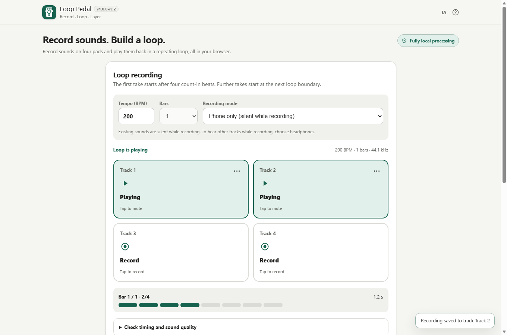

# Loop Pedal

Record sounds on four pads, loop each take to the same musical length, layer the tracks, and export a WAV file. Use everyday percussion, voice, guitar, or any sound picked up by your microphone.

[Japanese desktop screenshot](assets/screenshot.png) · [Mobile screenshot (390px)](assets/screenshot-mobile.png)

> **Release candidate v1.0.0-rc.2** — Based on the user's feedback, the earlier WAV-quality and one-beat-offset concerns were withdrawn. This candidate changes only the loop-edge treatment to reduce an unnatural transition, while retaining PCM and sample positions. This specific acoustic improvement still requires a human listening check; iPhone/Android and other release gates remain open.

[日本語 README](README.ja.md) · [Product specification](APP_SPEC.md) · [Acceptance matrix](ACCEPTANCE_MATRIX.md) · [Release candidate review](RELEASE_REVIEW.md)

## Features

- Four independent mono tracks, one committed take per pad.
- 40–200 BPM, 4/4, and 1/2/4 bars. Four-beat count-in for the first recording and loop-boundary quantization for later recordings.
- Sample-frame-based recording and a shared audio-clock loop for all tracks.
- Per-pad mute, gain, non-destructive timing adjustment (−200 to +200 ms, 5 ms steps), re-record, and last-recording Undo.
- Selective micro-fades at mismatched loop boundaries (up to ~4ms before the boundary and ~1ms after); unlike the earlier algorithm, they do not bend the quiet tail toward the first attack. Original recorded PCM and beat positions stay unchanged. Playback and WAV export use the same calculation.
- Collapsible browser audio diagnostics. These values do **not** constitute an input-latency calibration.
- Export 16-bit mono PCM WAV: one loop (without an end fade), 30 seconds, or 60 seconds (with a 0.25-second end fade). Editable and sanitized filenames.
- Cancellable progress during export, local audio preview, and an explicit retry-download link that remains available until tracks or export duration change.
- Japanese and English UI; each pad now indicates record/queued/recording/playing/paused/muted states in text and SVG, with screen-reader names.
- Background scrolling is locked for Help and track/confirmation dialogs, including smartphone safe-area handling.
- On audio interruption, uncommitted takes are discarded and finished tracks are preserved. A fully failed audio engine requires confirmed reload; unsaved takes cannot be recovered.
- The user-supplied `assets/favicon.svg` is embedded unchanged as both the favicon and the header icon. Audio is kept only in browser memory.
- Real browser screenshots are generated with Windows Edge and a synthetic microphone, not simulated DOM states. The screenshot capture can be repeated via `scripts/capture-screenshots.mjs`.

## How to use

1. Open the site over HTTPS or load the HTML in a supported browser; choose the tempo, length, and recording mode.
2. Select **Enable microphone** and grant permission. No permission prompt appears on page load.
3. Tap an empty pad. After four count-in beats, it automatically records the selected number of bars and begins looping.
4. Tap another empty pad to queue a recording on the next loop boundary. Tap a recorded pad to mute or unmute it.
5. Use a pad's settings to re-record, adjust gain/timing with ±5 ms buttons or reset, or delete it; the last committed recording can be undone. If the page loses audio focus, explicitly resume after returning.
6. Choose the export length and filename, then select **Download WAV**. Export temporarily pauses loop playback. While generating, use **Cancel export** to stop without losing your recordings. Once ready, preview the WAV in the built-in player and use **Download WAV again** if your browser didn't begin a download.
7. Download requests are initiated by the browser, but the app cannot verify whether your OS saved the file. Check the destination folder or files app. Editing a track or changing duration invalidates the earlier preview.

## Recording modes

**Phone only (default):** Previously recorded tracks and click sounds are silent during capture. This reduces speaker bleed but means you cannot listen to other tracks while recording.

**Layer with headphones:** Other tracks play while recording. Wired headphones are recommended. The microphone input is never monitored directly. Device- and Bluetooth-related latency is not guaranteed to be corrected automatically.

## Privacy and local data

Audio capture, PCM tracks and WAV export run in the browser. No audio is uploaded, automatically synced, or sent to analytics/telemetry. No runtime CDN is used. The generated HTML uses a `connect-src 'none'` Content Security Policy. Takes and prepared WAV previews are kept only in memory and disappear after refresh or closing the page. The WAV is held as a temporary local Blob URL; previous URLs are revoked when audio or output duration changes.

## Browser support and limitations

The app requires AudioWorklet, Web Audio API, Blob URL support and microphone permission. Browser/OS policies may require HTTPS or a secure local-file context. Direct `file://` operation, smartphone browsers, headphones, Bluetooth routing, background interruption and recovery still require physical-device verification.

This is not a DAW: no unlimited overdubbing, effects, project persistence or file import. Acoustic latency, loop-boundary noise and speaker bleed remain device-dependent and are release gates.

## Build and development

The repository follows [htmlapps-template](https://github.com/ttomohisa/htmlapps-template). Edit `src/index.template.html`, not generated HTML. On Windows run `build-standalone.bat` or `./scripts/check-repository.ps1`. Regular builds generate:

- `dist/index.html` — readable one-file app
- `dist/index.self-extract.html` — self-extracting one-file variant
- `loop-pedal.html` — root copy of the readable build
- `dist/build-size-report.json` — size report

Run `node --test tests/loop-pedal.test.cjs tests/release-audit.test.cjs` for deterministic clock/recording, WAV and release-policy tests. CI builds both standalone variants and validates icon and screenshot assets. The release screenshots are captured from the real app via `node scripts/capture-screenshots.mjs` on Windows Edge with a test-only microphone.

## License

[MIT](LICENSE). No third-party runtime packages are currently used. See [THIRD_PARTY_NOTICES.md](THIRD_PARTY_NOTICES.md).
